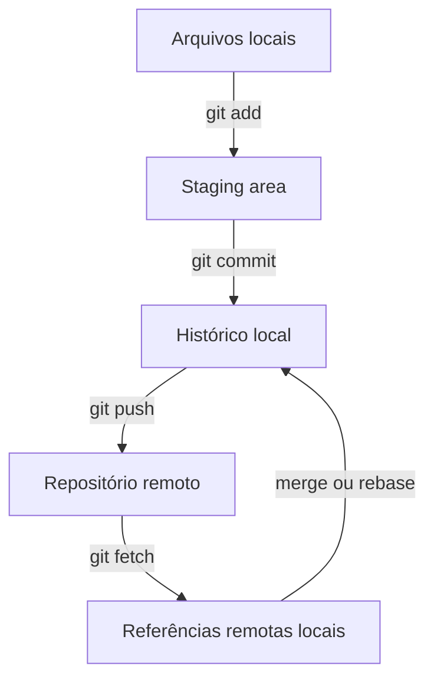
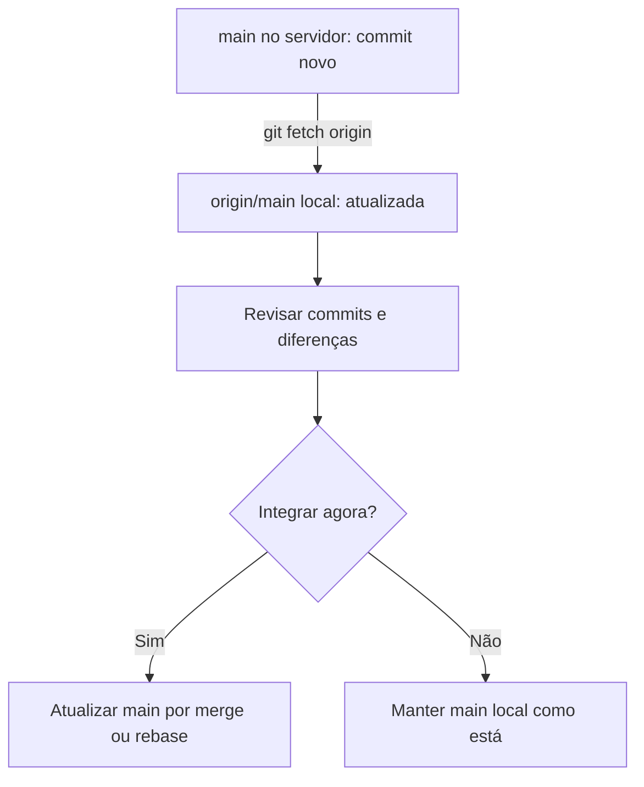
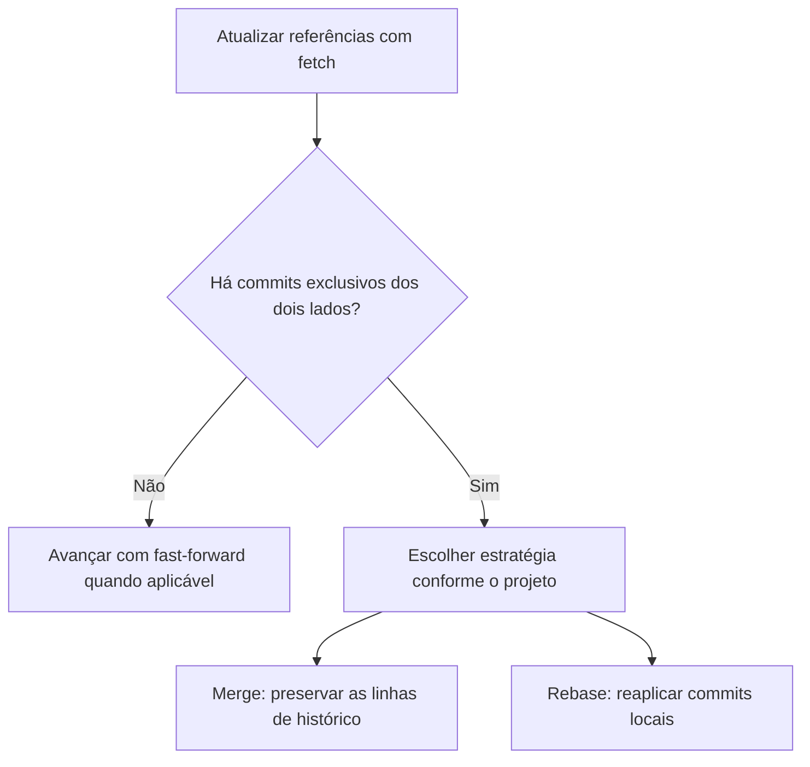

# Repositórios remotos no Git

## 1. O que é um repositório remoto?

Um repositório remoto é outro repositório Git com o qual o projeto pode trocar commits e referências.

Normalmente, ele fica em um serviço como GitHub, GitLab ou Bitbucket, mas também pode estar em outro servidor ou em um caminho local.

O remoto permite:

- Compartilhar commits.
- Colaborar com outras pessoas.
- Manter uma cópia publicada do histórico.
- Integrar mudanças desenvolvidas em máquinas diferentes.

**Git não sincroniza automaticamente todos os arquivos entre as máquinas.** A troca acontece por operações como `fetch`, `pull` e `push`.

## 2. Como as partes se relacionam



O `push` publica commits. Ele não envia edições que estejam apenas nos arquivos ou na staging area.

O `fetch` busca objetos e atualiza referências locais sobre o remoto. Ele não integra automaticamente as mudanças na branch atual.

## 3. Local, remoto e referência de acompanhamento

Existem três elementos diferentes:

| Elemento | Exemplo | Localização |
|---|---|---|
| Branch local | `main` | Repositório local |
| Referência de acompanhamento remoto | `origin/main` | Repositório local |
| Branch no remoto | `main` no GitHub | Repositório remoto |

`origin/main` representa o último estado conhecido da branch `main` do remoto `origin`.

Ela não é uma consulta em tempo real ao servidor.

### Exemplo

Se outra pessoa publicar um commit:

- A branch no servidor avança.
- Sua `main` local continua igual.
- Sua `origin/main` também pode continuar desatualizada.
- Após `git fetch origin`, sua `origin/main` passa a refletir o estado buscado.

## 4. O que é origin?

`origin` é o nome normalmente atribuído ao remoto criado por `git clone`.

É um apelido associado a uma URL, não uma palavra obrigatória nem uma branch.

Um projeto pode ter vários remotos:

| Nome comum | Uso |
|---|---|
| `origin` | Repositório principal usado pelo clone ou seu fork |
| `upstream` | Repositório original de um projeto com fork |
| `backup` | Outro destino configurado para publicação |

Esses nomes são convenções e podem ser alterados.

## 5. Clonar um repositório

```bash
git clone https://github.com/usuario/learning-hub.git
```

Normalmente, esse comando:

1. Cria o diretório do projeto.
2. Obtém objetos e histórico do remoto.
3. Configura o remoto `origin`.
4. Cria referências de acompanhamento remoto.
5. Faz checkout de uma branch inicial, conforme o remoto.

O clone padrão não cria uma branch local para cada branch do servidor.

### Escolher o nome do diretório

```bash
git clone https://github.com/usuario/learning-hub.git meus-estudos
```

Criar a cópia local em `meus-estudos`.

### Escolher a branch inicial

```bash
git clone --branch develop https://github.com/usuario/projeto.git
```

Selecionar `develop` como branch inicial, caso ela exista.

`--branch` não significa, sozinho, baixar somente aquela branch.

## 6. Consultar e configurar remotos

### Listar URLs

```bash
git remote -v
```

Exemplo:

```text
origin  https://github.com/usuario/learning-hub.git (fetch)
origin  https://github.com/usuario/learning-hub.git (push)
```

As URLs de busca e envio podem ser diferentes.

### Consultar detalhes

```bash
git remote show origin
```

Consultar informações sobre o remoto, como branches e configurações de acompanhamento.

Esse comando normalmente acessa o servidor.

### Adicionar um remoto

```bash
git remote add origin https://github.com/usuario/learning-hub.git
```

Associar um nome a uma URL.

**Isso não cria o repositório no GitHub nem publica commits.**

### Alterar a URL

```bash
git remote set-url origin git@github.com:usuario/learning-hub.git
```

Atualizar a URL associada ao remoto.

### Renomear um remoto

```bash
git remote rename origin github
```

Alterar o apelido local e atualizar as referências e configurações relacionadas.

### Remover um remoto

```bash
git remote remove backup
```

Remover sua configuração e referências de acompanhamento locais.

Isso não exclui o repositório no servidor.

## 7. HTTPS e SSH

| Protocolo | Exemplo | Autenticação comum |
|---|---|---|
| HTTPS | `https://github.com/usuario/projeto.git` | Credenciais gerenciadas, token ou fluxo do provedor |
| SSH | `git@github.com:usuario/projeto.git` | Chave SSH autorizada |

A configuração exata depende do provedor e do ambiente.

**Identidade de commit e autenticação são diferentes.**

```bash
git config user.name
git config user.email
```

Consultar a identidade dos commits. Esses valores não concedem acesso ao remoto.

## 8. Fetch: atualizar o conhecimento sobre o remoto

```bash
git fetch origin
```

Buscar objetos necessários e atualizar referências de acompanhamento conforme a configuração do remoto.

No uso comum, esse comando:

- Atualiza referências como `origin/main`.
- Não troca a branch atual.
- Não faz merge ou rebase.
- Não altera os arquivos do diretório de trabalho.

### Fluxo do fetch



### Buscar todos os remotos configurados

```bash
git fetch --all
```

Buscar os remotos configurados que participam dessa operação.

Isso não significa criar branches locais para todas as branches remotas.

### Limpar referências obsoletas

```bash
git fetch --prune origin
```

Remover referências de acompanhamento que deixaram de existir no remoto, conforme os mapeamentos configurados.

No uso comum:

- Uma branch foi excluída no servidor.
- Sua referência `origin/nome-da-branch` é removida localmente.
- Uma branch local com esse nome não é excluída.

## 9. Revisar depois do fetch

Após atualizar as referências:

```bash
git log --oneline main..origin/main
```

Mostrar commits conhecidos em `origin/main` que não estão em `main`.

```bash
git log --oneline origin/main..main
```

Mostrar commits de `main` que não estão em `origin/main`.

```bash
git diff main origin/main
```

Comparar os snapshots das duas referências.

```bash
git log --oneline --graph --decorate --all
```

Visualizar o relacionamento entre as branches.

## 10. Upstream: acompanhamento de uma branch

Uma branch local pode ter uma upstream, isto é, uma branch configurada como referência de acompanhamento.

Exemplo:

- Branch local: `estudos/arrays`.
- Upstream: `origin/estudos/arrays`.

Essa configuração ajuda o Git a definir padrões para operações e mostrar diferenças de histórico.

### Publicar e configurar acompanhamento

```bash
git push -u origin estudos/arrays
```

Enviar a branch e configurar sua upstream.

### Configurar uma upstream já existente

```bash
git branch --set-upstream-to=origin/main main
```

Configurar `main` para acompanhar `origin/main`.

Esse comando não integra commits nem publica alterações.

### Consultar o acompanhamento

```bash
git branch -vv
```

### Remover o acompanhamento

```bash
git branch --unset-upstream
```

Remover a configuração da branch atual, sem excluir branches ou commits.

**O remoto chamado `upstream` e a upstream de uma branch são conceitos diferentes.**

## 11. Ahead, behind e divergência

Depois de um fetch, comparar os históricos permite identificar a situação local:

| Situação | Significado |
|---|---|
| Ahead | Existem commits locais ausentes na referência de acompanhamento |
| Behind | Existem commits na referência de acompanhamento ausentes localmente |
| Ahead e behind | Os históricos divergiram |
| Sem diferença | As pontas coincidem |

### Consultar pelo status

```bash
git status -sb
```

A informação de ahead/behind depende da upstream e dos dados conhecidos localmente.

### Contar os commits de cada lado

```bash
git rev-list --left-right --count main...origin/main
```

Exemplo:

```text
2    3
```

Interpretação:

- `2`: commits exclusivos de `main`.
- `3`: commits exclusivos de `origin/main`.

Essas contagens se referem ao histórico, não à quantidade de arquivos alterados.

## 12. Pull: buscar e integrar

```bash
git pull
```

Buscar dados e integrar a branch selecionada na branch atual, conforme opções e configurações.

A integração pode usar merge ou rebase.

Para deixar a intenção explícita, escolher a estratégia.

### Pull com fast-forward obrigatório

```bash
git pull --ff-only
```

Atualizar a branch somente se for possível avançar sua referência sem criar um merge ou reescrever commits.

Se os históricos divergiram, o comando recusa a integração.

É uma opção útil quando se deseja evitar uma integração implícita.

### Pull com merge

```bash
git pull --no-rebase
```

Buscar e integrar usando merge.

Conforme o histórico e as opções, o resultado pode ser um fast-forward ou um commit de merge.

### Pull com rebase

```bash
git pull --rebase
```

Buscar e reaplicar os commits locais sobre a base atualizada.

O rebase pode gerar novos identificadores para os commits reaplicados.

**Evitar reescrever commits já compartilhados sem coordenar com a equipe.**

### Fluxo de decisão



Antes de integrar, revisar alterações locais. Um diretório de trabalho limpo facilita investigar e resolver eventuais conflitos.

## 13. Push: publicar commits

```bash
git push origin main
```

Publicar a branch local `main` na branch correspondente do remoto `origin`.

O servidor pode recusar a atualização por permissões, regras de proteção ou incompatibilidade de histórico.

### Publicar uma branch de trabalho

```bash
git push -u origin estudos/closures
```

Depois do acompanhamento configurado:

```bash
git push
```

O comportamento sem argumentos também depende das configurações de push do projeto.

### Publicar a branch atual explicitamente

```bash
git push origin HEAD:estudos/closures
```

Enviar o commit atual para a branch remota informada.

Nesse formato:

- Antes de `:`: origem local.
- Depois de `:`: destino no remoto.

## 14. Fast-forward e rejeição de push

Uma atualização fast-forward acontece quando o novo commit inclui a ponta anterior em seu histórico.

Isso permite avançar a branch sem descartar o histórico anterior.

Se outra pessoa publicou commits que não estão na sua branch, um push comum pode ser recusado com indicação de non-fast-forward.

### Procedimento de investigação

```bash
git fetch origin
git log --oneline --graph --decorate --all
```

Depois:

1. Entender quais commits existem de cada lado.
2. Integrar as mudanças por merge ou rebase, conforme o fluxo do projeto.
3. Resolver conflitos, se existirem.
4. Verificar o resultado e executar os testes relevantes.
5. Tentar o push novamente.

**Não usar força apenas para fazer uma rejeição desaparecer.**

## 15. Force push e force-with-lease

```bash
git push --force
```

Permitir sobrescrever o histórico da branch remota quando o servidor aceitar.

Isso pode retirar da branch commits publicados por outras pessoas.

### Proteção adicional

```bash
git push --force-with-lease origin estudos/closures
```

Solicitar a atualização forçada somente se a referência remota corresponder ao estado esperado.

Sem uma expectativa explícita, essa verificação normalmente usa a referência de acompanhamento local.

Essa proteção reduz o risco, mas não substitui a revisão. Um fetch automático pode atualizar a referência local usada como expectativa.

Usar somente quando houver uma razão concreta para publicar histórico reescrito e isso for permitido pelo projeto.

## 16. Trabalhar com uma branch remota existente

```bash
git fetch origin
git switch -c estudos/arrays --track origin/estudos/arrays
```

Criar uma branch local a partir da referência remota e configurar seu acompanhamento.

Executar a criação apenas se a branch local ainda não existir.

Para listar as referências conhecidas:

```bash
git branch -r
```

## 17. Excluir uma branch publicada

```bash
git push origin --delete estudos/arrays
```

Excluir a branch no servidor.

Essa ação não exclui automaticamente a branch local.

Após uma exclusão realizada por outra pessoa:

```bash
git fetch --prune origin
```

Atualizar e limpar as referências locais obsoletas.

Antes de excluir, conferir se o trabalho foi integrado ou se deve permanecer disponível.

## 18. Fork e múltiplos remotos

Um fork é um repositório separado, normalmente criado a partir de outro no serviço de hospedagem.

Um fluxo comum usa:

- `origin`: seu fork.
- `upstream`: projeto original.

### Configurar o projeto original

```bash
git remote add upstream https://github.com/organizacao/projeto.git
git fetch upstream
```

### Atualizar sua main local

```bash
git switch main
git merge --ff-only upstream/main
```

Esse merge só funciona se o avanço puder ser realizado por fast-forward.

### Publicar a atualização no fork

```bash
git push origin main
```

Esse fluxo pressupõe que sua `main` acompanha a linha do projeto original e não possui divergências.

Não presumir que adicionar `upstream` configura automaticamente o acompanhamento de todas as branches.

## 19. Problemas comuns

| Mensagem ou situação | O que verificar |
|---|---|
| `remote origin already exists` | Consultar o remoto existente antes de adicionar outro |
| `repository not found` | Conferir URL, existência e permissões |
| Falha de autenticação | Conferir credenciais ou chave SSH |
| Branch sem upstream | Configurar acompanhamento com o destino correto |
| Push rejeitado por non-fast-forward | Buscar e investigar a divergência |
| Branch protegida | Seguir o fluxo de pull request e as regras do servidor |
| Referência remota aparentemente desatualizada | Executar fetch |
| Alterações locais impedindo integração | Registrar, guardar ou revisar as alterações antes de continuar |

## 20. Fluxo diário de trabalho

O exemplo abaixo pressupõe uma branch `main` e um remoto `origin` configurados.

### Atualizar a base

```bash
git switch main
git status
git fetch origin
git merge --ff-only origin/main
```

Se houver divergência, investigar antes de escolher outra estratégia.

### Criar uma branch de trabalho

```bash
git switch -c estudos/async-await
```

Editar os arquivos e revisar:

```bash
git diff
git add async-await.js
git diff --staged
git commit -m "docs: adicionar exemplos de async e await"
```

### Publicar

```bash
git push -u origin estudos/async-await
```

Depois, abrir um pull request no serviço de hospedagem quando esse for o fluxo do projeto.

**O push publica a branch; o pull request propõe sua integração.**

## Exercício prático

Usar um repositório de prática, com um remoto vazio preparado para o exercício.

1. Consultar o remoto com `git remote -v`.
2. Publicar a branch principal com `git push -u origin main`.
3. Fazer um segundo clone em outro diretório.
4. No segundo clone, criar um commit e publicar.
5. Voltar ao primeiro clone e executar `git fetch origin`.
6. Comparar `main` com `origin/main`.
7. Confirmar que o fetch não atualizou os arquivos.
8. Integrar com `git merge --ff-only origin/main`.
9. Verificar que o novo commit e seu conteúdo chegaram à branch local.

## Resumo dos comandos

| Comando | Finalidade |
|---|---|
| `git clone URL` | Criar uma cópia local |
| `git remote -v` | Consultar remotos |
| `git fetch origin` | Atualizar o conhecimento local sobre o remoto |
| `git fetch --prune origin` | Atualizar e limpar referências obsoletas |
| `git branch -vv` | Consultar acompanhamento |
| `git pull --ff-only` | Buscar e integrar somente por fast-forward |
| `git pull --rebase` | Buscar e reaplicar commits locais |
| `git push -u origin BRANCH` | Publicar e configurar acompanhamento |
| `git push` | Publicar conforme as configurações |
| `git push origin --delete BRANCH` | Excluir uma branch no servidor |

## Pontos de atenção

- Um remoto é outro repositório, não uma área de preparação.
- `origin/main` é uma referência local sobre o remoto.
- Fetch não integra mudanças na branch atual.
- Pull busca e integra.
- Push publica commits, não edições soltas.
- Ahead e behind dependem das referências conhecidas localmente.
- Branches protegidas podem exigir revisão antes da integração.
- Evitar sobrescrever histórico compartilhado sem necessidade e coordenação.