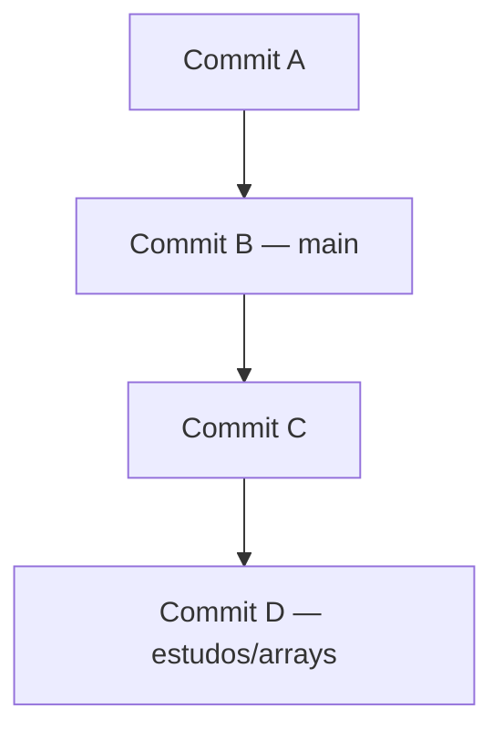
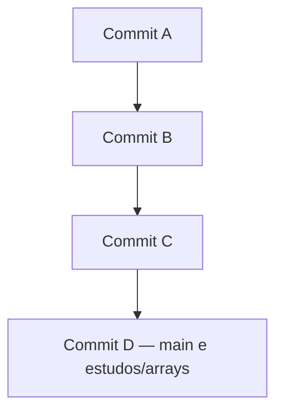
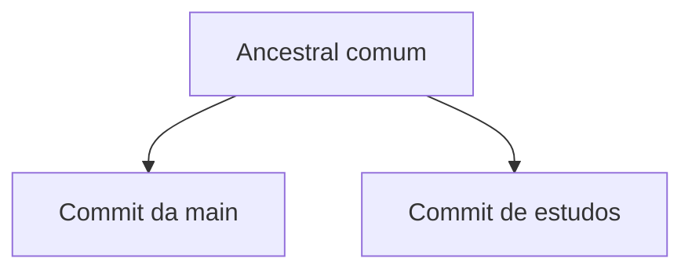
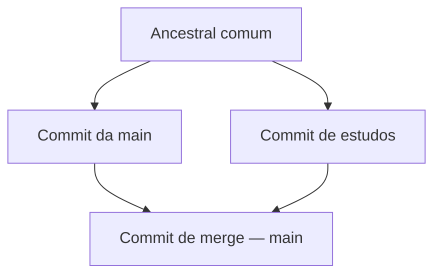
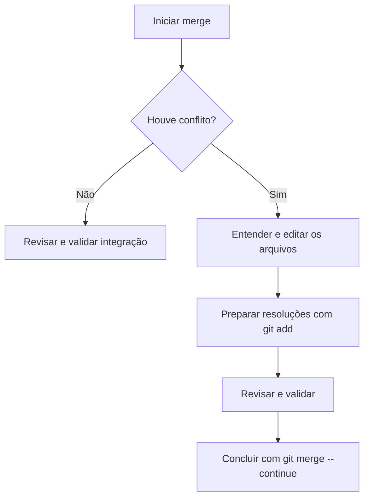

# Merge e resolução de conflitos

## 1. O que é merge?

Merge é a operação que integra históricos de desenvolvimento.

O comando abaixo integra a branch `estudos/arrays` **na branch atual**:

```bash
git merge estudos/arrays
```

A direção importa:

- Branch atual: recebe a integração.
- Branch informada: fornece o histórico a integrar.

O merge não exclui a branch integrada.

### Integrar uma branch na main

```bash
git switch main
git merge estudos/arrays
```

Antes de começar, revisar o estado dos arquivos:

```bash
git status
```

Preferir iniciar a integração com o diretório de trabalho e a staging area limpos.

## 2. Tipos de resultado

| Situação | Resultado comum |
|---|---|
| A branch atual pode avançar diretamente até a outra | Fast-forward |
| As duas branches possuem commits exclusivos | Merge com integração dos históricos |
| As alterações não podem ser conciliadas automaticamente | Conflitos |
| O histórico informado já está contido no atual | `Already up to date` |

## 3. Fast-forward

Fast-forward é um avanço da referência da branch.

Ele ocorre quando a ponta atual é ancestral da branch que será integrada.

### Antes



### Comando

```bash
git switch main
git merge --ff-only estudos/arrays
```

### Depois



A `main` passa a apontar para o mesmo commit da branch integrada.

**Nenhum commit de merge é criado.**

A opção `--ff-only` recusa a operação se o avanço direto não for possível.

## 4. Merge com históricos divergentes

Quando ambas as branches possuem commits exclusivos, o Git precisa combinar os históricos.

### Antes



### Depois da integração



O commit de merge registra o resultado integrado e possui, normalmente, dois pais:

1. A ponta anterior da branch atual.
2. A ponta da branch integrada.

Isso preserva a relação entre as duas linhas de desenvolvimento.

### Comando

```bash
git switch main
git merge estudos/arrays
```

Se não houver conflitos, o Git pode concluir automaticamente e abrir um editor para a mensagem do commit.

## 5. Como o Git combina alterações

Em um merge comum de duas branches divergentes, o Git utiliza:

- Uma base comum.
- A versão da branch atual.
- A versão da branch integrada.

Essa combinação é chamada de **three-way merge**, ou merge de três vias.

O Git consegue integrar muitas alterações sozinho, inclusive mudanças no mesmo arquivo quando não entram em conflito.

**Alterar o mesmo arquivo não significa necessariamente gerar conflito.**

## 6. O que é um conflito?

Um conflito ocorre quando o Git não consegue decidir automaticamente como conciliar determinadas alterações.

Exemplos comuns:

| Situação | Exemplo |
|---|---|
| Alterações sobrepostas | As duas branches modificam a mesma região |
| Modificação e exclusão | Uma branch altera um arquivo e a outra o remove |
| Adições incompatíveis | As duas branches adicionam o mesmo caminho com conteúdos diferentes |
| Renomeações incompatíveis | As branches renomeiam um arquivo de formas diferentes |

O conflito exige uma decisão sobre o resultado correto.

**Resolver não significa escolher uma versão inteira obrigatoriamente.** A solução pode combinar partes das duas ou introduzir outro conteúdo.

## 7. Conflito textual

Supondo que as branches tenham alterado o mesmo limite:

### main

```javascript
const limiteTentativas = 5;
```

### estudos/login

```javascript
const limiteTentativas = 3;
```

Ao integrar:

```bash
git switch main
git merge estudos/login
```

O arquivo pode apresentar:

```text
<<<<<<< HEAD
const limiteTentativas = 5;
=======
const limiteTentativas = 3;
>>>>>>> estudos/login
```

### Significado dos marcadores

| Marcador | Significado |
|---|---|
| `<<<<<<< HEAD` | Início do conteúdo da branch atual |
| `=======` | Separação entre as versões |
| `>>>>>>> estudos/login` | Fim do conteúdo vindo da outra branch |

Nesse exemplo, a integração foi iniciada em `main`:

- Parte superior: versão de `main`.
- Parte inferior: versão de `estudos/login`.

Os marcadores fazem parte temporariamente do arquivo e precisam ser removidos.

## 8. Resolver um conflito passo a passo

### 1. Identificar o estado

```bash
git status
```

Verificar os arquivos em conflito e confirmar que existe um merge em andamento.

### 2. Inspecionar as diferenças

```bash
git diff
```

Revisar os trechos não resolvidos.

### 3. Entender a intenção das mudanças

```bash
git log --oneline main..estudos/login
```

Consultar os commits da branch integrada que não estão em `main`.

Quando necessário:

```bash
git show IDENTIFICADOR_DO_COMMIT
```

Substituir pelo identificador real.

### 4. Editar o resultado final

Remover os marcadores e manter a implementação correta:

```javascript
const limiteTentativas = 3;
```

Essa escolha deve seguir a regra de negócio, não a posição do conteúdo no conflito.

### 5. Marcar o arquivo como resolvido

```bash
git add login.js
```

O `add` registra o conteúdo escolhido na staging area e resolve a pendência daquele arquivo para o Git.

**O Git não verifica se a solução está correta.** É possível preparar um arquivo ainda contendo marcadores ou erros de lógica.

### 6. Revisar a integração

```bash
git status
git diff --staged
git diff --staged --check
```

- Conferir se restam arquivos não resolvidos.
- Revisar o conteúdo preparado.
- Verificar problemas de espaços e marcadores de conflito detectáveis pelo check.

### 7. Validar o comportamento

Executar os testes, a análise estática ou as verificações apropriadas ao projeto.

Um merge sem conflitos textuais ainda pode introduzir problemas de comportamento.

### 8. Concluir

```bash
git merge --continue
```

Concluir o merge e editar a mensagem, se necessário.

Também é possível usar `git commit` para concluir um merge após resolver e preparar todos os conflitos.

## 9. Fluxo de resolução



## 10. Ours e theirs

Durante um merge comum:

| Termo | Conteúdo |
|---|---|
| `ours` | Versão da branch atual |
| `theirs` | Versão da branch integrada |

### Manter a versão atual de um arquivo em conflito

```bash
git restore --ours -- login.js
git add login.js
```

### Manter a versão da branch integrada

```bash
git restore --theirs -- login.js
git add login.js
```

Esses comandos selecionam uma versão inteira do arquivo, podendo descartar alterações úteis do outro lado.

Usar quando essa for realmente a solução desejada, e revisar antes de concluir.

**Durante um rebase, a interpretação desses lados muda em relação à branch de trabalho. Não aplicar essa tabela ao rebase sem analisar o contexto.**

## 11. Consultar as três versões de um conflito

Durante um conflito comum, o index pode manter versões especiais do arquivo:

| Estágio | Conteúdo |
|---|---|
| `1` | Base comum |
| `2` | Nossa versão |
| `3` | Versão integrada |

### Consultar a base

```bash
git show :1:login.js
```

### Consultar nossa versão

```bash
git show :2:login.js
```

### Consultar a versão integrada

```bash
git show :3:login.js
```

Usar caminhos relativos à raiz do repositório.

Nem todo conflito possui os três estágios. Em um conflito de adição contra adição, por exemplo, pode não existir uma base para o arquivo.

### Listar entradas não resolvidas

```bash
git ls-files --unmerged
```

Esse comando ajuda a identificar os estágios presentes.

## 12. Mostrar a base nos marcadores

O estilo `diff3` inclui a versão da base comum no arquivo em conflito.

```bash
git config merge.conflictStyle diff3
```

Configurar o estilo para o repositório atual.

Exemplo de apresentação:

```text
<<<<<<< HEAD
const limite = 5;
||||||| base
const limite = 4;
=======
const limite = 3;
>>>>>>> estudos/login
```

A base ajuda a entender o que cada lado alterou.

Essa configuração afeta como os conflitos são apresentados; ela não resolve os conflitos automaticamente.

## 13. Conflito de modificação e exclusão

Essa situação acontece quando uma branch modifica um arquivo que a outra excluiu.

O arquivo pode permanecer no diretório de trabalho para permitir a decisão.

### Manter o arquivo

Revisar seu conteúdo e preparar:

```bash
git add arquivo.js
```

### Confirmar a exclusão

```bash
git rm arquivo.js
```

Depois, resolver os demais conflitos e concluir o merge.

Não depender apenas de marcadores textuais: alguns tipos de conflito são identificados principalmente pelo `git status`.

## 14. Ferramentas visuais

Editores como VS Code podem oferecer:

- Aceitar alteração atual.
- Aceitar alteração recebida.
- Aceitar ambas.
- Abrir editor de merge.

Essas opções ajudam a editar, mas não determinam a solução correta.

**Aceitar ambas pode duplicar funções, declarações ou regras incompatíveis.**

Após usar a ferramenta:

1. Ler o resultado final.
2. Verificar sintaxe e comportamento.
3. Preparar o arquivo.
4. Concluir a integração.

## 15. Abortar um merge

```bash
git merge --abort
```

Tentar retornar ao estado anterior ao início do merge.

Esse comando se aplica a um merge ainda em andamento. Ele não desfaz um merge já concluído.

Se havia alterações locais antes da operação, pode não ser possível reconstruí-las perfeitamente em todos os casos.

Por isso, preferir começar com alterações registradas ou guardadas adequadamente.

## 16. Opções úteis de merge

### Aceitar somente fast-forward

```bash
git merge --ff-only estudos/arrays
```

Recusar a integração se houver divergência.

### Criar um commit de merge mesmo quando fast-forward seria possível

```bash
git merge --no-ff estudos/arrays
```

Preservar explicitamente a integração da branch no histórico.

### Revisar antes de criar o commit de merge

```bash
git merge --no-ff --no-commit estudos/arrays
```

Preparar a integração e parar antes do commit.

Depois de revisar e validar:

```bash
git commit
```

`--no-commit` sozinho não interrompe um fast-forward, pois esse avanço não cria commit. O uso de `--no-ff` evita esse caso.

### Integrar como um único commit comum

```bash
git merge --squash estudos/arrays
```

Preparar o resultado combinado sem criar um commit de merge.

Depois:

```bash
git commit -m "feat: adicionar exercícios de arrays"
```

O commit resultante não possui a branch integrada como segundo pai.

Por isso, mesmo com o conteúdo incorporado, verificações de ancestralidade podem continuar mostrando os commits originais como não integrados.

## 17. Conflitos textuais e conflitos de comportamento

### Conflito textual

O Git identifica uma sobreposição que não consegue resolver e interrompe a integração.

### Conflito de comportamento

O Git combina os arquivos automaticamente, mas o resultado deixa de funcionar corretamente.

Exemplo:

- Uma branch renomeia um campo da resposta da API.
- Outra adiciona uma tela que depende do nome antigo.
- O merge termina sem conflito textual.
- A tela falha durante a execução.

**Ausência de conflitos não garante uma integração correta.**

## 18. Revisar o merge concluído

### Visualizar o histórico

```bash
git log --oneline --graph --decorate --all
```

### Consultar o commit

```bash
git show --stat HEAD
```

### Comparar o resultado com a branch antes do merge

Se `HEAD` for um commit de merge:

```bash
git diff HEAD^1 HEAD
```

Comparar o resultado com o primeiro pai.

```bash
git diff HEAD^2 HEAD
```

Comparar o resultado com o segundo pai.

Essas referências pressupõem que o commit realmente possui dois pais. Elas não se aplicam da mesma forma a fast-forward ou squash.

## 19. Publicar a integração

Após concluir e validar:

```bash
git push origin main
```

Executar somente quando o fluxo do projeto permitir publicar diretamente na principal.

Em equipes, é comum:

1. Publicar uma branch de trabalho.
2. Abrir um pull request.
3. Executar verificações.
4. Receber revisão.
5. Integrar conforme as regras do repositório.

Um pull request é um recurso da plataforma de hospedagem; ele não é um comando nativo do Git.

## 20. Desfazer um merge já registrado

Se o merge já foi concluído, `git merge --abort` não se aplica.

Para um commit de merge publicado, uma opção é criar um commit de reversão:

```bash
git revert -m 1 IDENTIFICADOR_DO_MERGE
```

A opção `-m 1` escolhe o primeiro pai como linha principal e reverte a diferença introduzida pelo merge em relação a ele.

Essa operação exige cuidado:

- Pode gerar conflitos.
- Não remove o merge do histórico.
- Afeta a forma como futuras integrações daquele histórico são interpretadas.
- O número do pai deve ser confirmado, não escolhido automaticamente.

Estudar `revert` com mais profundidade antes de usar em uma branch compartilhada.

## Exercício prático: provocar e resolver um conflito

Executar em um repositório de prática com identidade de commit configurada.

### 1. Criar a base

Criar um repositório vazio:

```bash
git init -b main
```

Criar `config.js` com:

```javascript
const limite = 3;
```

Registrar:

```bash
git add config.js
git commit -m "chore: adicionar configuração inicial"
```

### 2. Criar uma alteração em outra branch

```bash
git switch -c estudos/limite
```

Alterar o arquivo para:

```javascript
const limite = 5;
```

Registrar:

```bash
git add config.js
git commit -m "feat: aumentar limite para cinco"
```

### 3. Alterar a mesma linha na main

```bash
git switch main
```

Alterar o arquivo para:

```javascript
const limite = 4;
```

Registrar:

```bash
git add config.js
git commit -m "feat: ajustar limite para quatro"
```

### 4. Iniciar a integração

```bash
git merge estudos/limite
git status
```

O Git deve identificar o conflito na linha alterada.

### 5. Resolver

Editar `config.js`, remover os marcadores e escolher o resultado desejado.

Depois:

```bash
git add config.js
git diff --staged
git diff --staged --check
git merge --continue
```

### 6. Conferir

```bash
git status
git log --oneline --graph --decorate
git diff HEAD^1 HEAD
```

**Resultado esperado:** um commit de merge com dois pais e um arquivo final sem marcadores.

## Resumo dos comandos

| Comando | Finalidade |
|---|---|
| `git merge BRANCH` | Integrar na branch atual |
| `git merge --ff-only BRANCH` | Permitir somente avanço direto |
| `git merge --no-ff BRANCH` | Criar merge explícito quando houver integração |
| `git status` | Identificar arquivos não resolvidos |
| `git diff` | Revisar alterações e conflitos |
| `git add ARQUIVO` | Preparar a resolução |
| `git merge --continue` | Concluir um merge pendente |
| `git merge --abort` | Tentar cancelar um merge em andamento |
| `git diff HEAD^1 HEAD` | Comparar o merge com seu primeiro pai |

## Pontos de atenção

- Confirmar a branch que receberá a integração.
- Começar com o trabalho local organizado.
- Entender a intenção das duas alterações antes de escolher uma solução.
- Não aceitar um lado inteiro sem revisar o que será descartado.
- Remover todos os marcadores e validar o resultado.
- Considerar conflitos de comportamento mesmo quando o merge for automático.
- Não confundir abortar uma operação pendente com reverter um merge concluído.