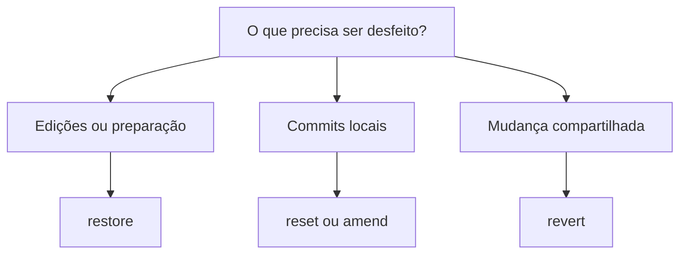
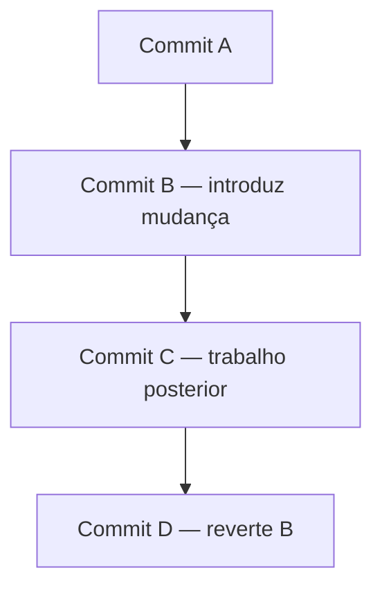
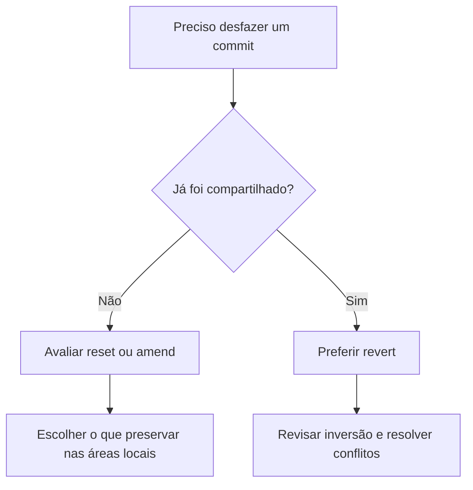

# Desfazer alterações e recuperar trabalho no Git

## 1. Escolher o comando pela intenção

Desfazer uma alteração pode significar coisas diferentes:

- Retirar conteúdo do próximo commit.
- Descartar uma edição local.
- Corrigir o último commit.
- Reposicionar uma branch.
- Reverter uma mudança publicada.
- Recuperar um commit que perdeu sua branch.

| Objetivo | Comando principal |
|---|---|
| Retirar alterações da staging sem perder edições | `git restore --staged` |
| Descartar alterações não preparadas | `git restore` |
| Reposicionar a branch e ajustar as áreas locais | `git reset` |
| Criar um commit que desfaz outro | `git revert` |
| Localizar posições anteriores das referências | `git reflog` |
| Corrigir o último commit | `git commit --amend` |
| Remover arquivos untracked | `git clean` |

**Antes de executar, identificar quais áreas serão alteradas e se o histórico já foi compartilhado.**

## 2. Relembrar as áreas

| Área | Conteúdo |
|---|---|
| HEAD | Commit atual |
| Staging area — index | Conteúdo preparado para o próximo commit |
| Diretório de trabalho | Arquivos presentes para edição |

Os comandos deste resumo podem atuar em uma ou mais dessas áreas.



O gráfico apresenta os usos mais comuns. A escolha final depende do estado do repositório.

## 3. Inspecionar antes de desfazer

```bash
git status
git diff
git diff --staged
git log -5 --oneline
```

Esses comandos ajudam a responder:

1. Existem alterações não preparadas?
2. Existe conteúdo preparado?
3. Quais commits serão afetados?
4. O trabalho já está publicado?

O histórico local pode não refletir a situação atual do servidor. Quando necessário, buscar atualizações com `git fetch`.

## 4. Restore: retirar alterações da staging

```bash
git restore --staged -- anotacoes.md
```

Restaurar a entrada da staging conforme o HEAD, preservando o arquivo no diretório de trabalho.

### Exemplo

| Área | Antes | Depois |
|---|---|---|
| HEAD | Versão A | Versão A |
| Staging | Versão B | Versão A |
| Diretório de trabalho | Versão B | Versão B |

A edição continua no arquivo, mas deixa de entrar no próximo commit.

Para um arquivo novo preparado, a operação normalmente faz com que ele volte a ser untracked.

### Retirar todos os arquivos da staging

A partir da raiz do repositório:

```bash
git restore --staged -- .
```

Esse comando pressupõe um HEAD existente. Antes do primeiro commit, consultar o cenário específico mais adiante.

## 5. Restore: descartar edições não preparadas

```bash
git restore -- anotacoes.md
```

Restaurar o arquivo no diretório de trabalho a partir da staging area.

### Exemplo

| Área | Antes | Depois |
|---|---|---|
| HEAD | Versão A | Versão A |
| Staging | Versão B | Versão B |
| Diretório de trabalho | Versão C | Versão B |

**A versão C é descartada.**

Esse comando não significa necessariamente voltar ao último commit: a origem padrão, nesse caso, é a staging area.

### Restaurar todos os caminhos do diretório atual

```bash
git restore -- .
```

Descartar alterações não preparadas nos caminhos abrangidos.

Revisar antes, pois conteúdo nunca preservado pode não ser recuperável.

## 6. Restaurar um arquivo de um commit específico

```bash
git restore --source=HEAD~1 -- anotacoes.md
```

Trazer o conteúdo daquele commit para o diretório de trabalho.

A branch não é reposicionada e a staging não é atualizada.

Para registrar essa restauração:

```bash
git add anotacoes.md
git commit -m "docs: restaurar versão anterior das anotações"
```

### Restaurar staging e diretório de trabalho

```bash
git restore --source=HEAD --staged --worktree -- anotacoes.md
```

Fazer as duas áreas corresponderem ao HEAD para o caminho informado.

**Isso descarta alterações preparadas e não preparadas daquele caminho.**

## 7. Reset: reposicionar o histórico local

Quando executado com um commit e sem caminhos, `git reset` reposiciona o HEAD e, se houver uma branch atual, sua referência.

O modo escolhido determina o que acontece com staging e diretório de trabalho.

| Modo | HEAD/branch | Staging | Diretório de trabalho |
|---|---|---|---|
| `--soft` | Mover para o destino | Preservar | Preservar |
| `--mixed` | Mover para o destino | Ajustar ao destino | Preservar |
| `--hard` | Mover para o destino | Ajustar ao destino | Ajustar ao destino |

`--mixed` é o modo padrão.

**Reposicionar uma branch não apaga imediatamente os commits anteriores.** Eles podem continuar acessíveis por outras referências ou pelo reflog.

## 8. Reset soft: refazer commits mantendo a preparação

```bash
git reset --soft HEAD~1
```

Voltar a branch para o primeiro pai, preservando staging e arquivos.

Se tudo estava limpo antes da operação, as alterações do último commit ficam preparadas.

### Uso comum

Refazer um commit local:

```bash
git reset --soft HEAD~1
git diff --staged
git commit -m "docs: reorganizar anotações"
```

O comando não aplica uma operação inversa aos arquivos. Ele muda a posição da branch e mantém o conteúdo local.

## 9. Reset mixed: manter o trabalho sem preparação

```bash
git reset --mixed HEAD~1
```

Voltar a branch para o primeiro pai e ajustar a staging ao destino, preservando o diretório de trabalho.

Se o estado estava limpo, as alterações do commit removido da ponta ficam como edições locais não preparadas.

A forma abaixo é equivalente:

```bash
git reset HEAD~1
```

### Uso comum

Reorganizar um commit local em vários:

```bash
git reset HEAD~1
git add -p
git commit -m "docs: adicionar conceitos de escopo"
```

Depois, preparar e registrar as alterações restantes.

## 10. Reset hard: descartar conteúdo local

```bash
git reset --hard HEAD~1
```

Reposicionar a branch e fazer staging e arquivos acompanhados corresponderem ao commit indicado.

Isso pode descartar:

- Alterações preparadas.
- Alterações não preparadas.
- O acesso direto ao commit que estava na ponta da branch.

Também pode remover arquivos ou diretórios untracked que impeçam a escrita dos caminhos restaurados.

**Não usar como um comando genérico de limpeza.**

### Permanecer no commit atual e descartar alterações

```bash
git reset --hard HEAD
```

Manter a posição atual e restaurar staging e arquivos acompanhados ao HEAD.

Antes de uma operação desse tipo, preservar o trabalho necessário com commit, stash ou outra cópia apropriada.

## 11. Reset com caminhos

```bash
git reset HEAD -- anotacoes.md
```

Restaurar somente a entrada da staging daquele caminho conforme o HEAD.

Nesse formato:

- Não mover a branch.
- Não alterar o arquivo no diretório de trabalho.
- Retirar alterações da staging.

Para essa intenção, a alternativa mais explícita é:

```bash
git restore --staged -- anotacoes.md
```

**Reset com caminhos e reset para um commit sem caminhos têm comportamentos diferentes.**

## 12. Comparação prática dos modos

Supondo que:

- O commit A contenha `const pontos = 10;`.
- O commit B contenha `const pontos = 20;`.
- A branch esteja em B, com staging e arquivos limpos.

Após cada operação, separadamente:

| Operação | HEAD | Staging | Arquivo |
|---|---|---|---|
| `git reset --soft HEAD~1` | A: `10` | `20` | `20` |
| `git reset --mixed HEAD~1` | A: `10` | `10` | `20` |
| `git reset --hard HEAD~1` | A: `10` | `10` | `10` |

A diferença central é o que fica preservado depois de mover a branch.

## 13. Revert: desfazer com outro commit

```bash
git revert IDENTIFICADOR_DO_COMMIT
```

Criar um novo commit que aplica a inversão das alterações do commit escolhido.

Diferentemente de reset, o revert não remove o commit original do histórico da branch.

### Exemplo



O commit D tenta desfazer B preservando as alterações posteriores que forem compatíveis.

**Revert não significa restaurar todo o projeto ao estado anterior a B.**

### Reverter o último commit

```bash
git revert HEAD
```

### Preparar a inversão sem criar o commit

```bash
git revert --no-commit IDENTIFICADOR_DO_COMMIT
git diff --staged
git commit -m "revert: remover comportamento incorreto"
```

Começar com as alterações locais organizadas para facilitar a revisão.

## 14. Conflitos durante revert

Um revert pode gerar conflitos quando alterações posteriores dependem do conteúdo que será desfeito.

### Resolver

```bash
git status
```

Editar os arquivos e definir o resultado correto.

```bash
git add arquivo-resolvido.js
git revert --continue
```

### Cancelar a operação em andamento

```bash
git revert --abort
```

Retornar ao estado anterior ao início da sequência de revert.

## 15. Reverter um merge

Um commit de merge normalmente possui dois pais. Para revertê-lo, indicar qual pai será considerado a linha principal:

```bash
git revert -m 1 IDENTIFICADOR_DO_MERGE
```

Nesse caso, aplicar a inversão das alterações do merge em relação ao primeiro pai.

A opção `-m` significa escolher o número do pai principal. Ela não define a mensagem do commit.

### Conferir os pais

```bash
git show --no-patch --format="%H %P" IDENTIFICADOR_DO_MERGE
```

A saída apresenta o commit e seus pais, na ordem.

Reverter um merge não remove a relação de ancestralidade. Por isso, tentar integrar novamente a mesma branch pode não reaplicar automaticamente o conteúdo revertido.

Planejar a correção antes de reutilizar esse histórico.

## 16. Amend: corrigir o último commit

```bash
git commit --amend
```

Substituir o commit atual por outro, usando a staging e permitindo editar a mensagem.

O commit anterior não é modificado internamente. Um novo commit é criado, normalmente com outro identificador.

### Corrigir somente a mensagem

Primeiro, verificar que não existem alterações preparadas:

```bash
git diff --staged
git commit --amend -m "docs: corrigir descrição do estudo"
```

Se houver alterações na staging, elas também entrarão no novo commit.

### Incluir um arquivo esquecido

```bash
git add arquivo-esquecido.js
git commit --amend --no-edit
```

Substituir o último commit mantendo sua mensagem e incluindo o conteúdo preparado.

**Preferir amend para commits ainda não compartilhados.** Se o commit já foi publicado, a substituição exige coordenar a reescrita do histórico.

## 17. Reflog: localizar posições anteriores

O reflog registra movimentações locais de referências, incluindo mudanças no HEAD.

Ele pode ajudar a encontrar commits após:

- Reset.
- Amend.
- Rebase.
- Trabalho em detached HEAD.
- Exclusão de uma branch, quando o commit ainda estiver acessível nos registros disponíveis.

```bash
git reflog
```

Exemplo:

```text
a1b2c3d HEAD@{0}: reset: moving to HEAD~1
b2c3d4e HEAD@{1}: commit: adicionar exercício
a1b2c3d HEAD@{2}: commit: iniciar estudo
```

Nesse exemplo, `b2c3d4e` identifica o commit anterior ao reset.

### Inspecionar antes de recuperar

```bash
git show b2c3d4e
```

### Criar uma branch de recuperação

```bash
git branch recuperacao/exercicio b2c3d4e
```

Essa abordagem preserva uma referência para o commit sem alterar imediatamente os arquivos atuais.

Depois:

```bash
git switch recuperacao/exercicio
```

A troca depende de não sobrescrever alterações locais.

### Referências com chaves no PowerShell

Ao usar uma expressão do reflog, colocá-la entre aspas:

```bash
git show 'HEAD@{1}'
```

O número representa uma entrada do reflog, não uma quantidade de commits anteriores.

## 18. Limites da recuperação

O reflog:

- É local.
- Não acompanha automaticamente o clone de outra pessoa.
- Possui retenção limitada.
- Não é um backup permanente.
- Não registra cada edição feita no editor.

Commits sem referências podem ser removidos pela manutenção do Git após os períodos aplicáveis.

**Uma alteração nunca registrada nem preservada pode não ser recuperável pelo Git.**

## 19. Clean: remover arquivos não acompanhados

`git restore` não remove arquivos untracked.

Para listar candidatos à remoção:

```bash
git clean -n
```

Incluir diretórios na prévia:

```bash
git clean -nd
```

### Executar a remoção

```bash
git clean -fd
```

Remover arquivos e diretórios untracked que não estejam protegidos pelas regras de exclusão aplicáveis.

Essa operação não cria um commit nem envia os arquivos para uma lixeira do Git.

### Incluir arquivos ignorados

```bash
git clean -ndx
```

Mostrar uma prévia incluindo arquivos ignorados.

```bash
git clean -fdx
```

Remover também arquivos ignorados, como dependências, saídas de build ou configurações locais.

**Conferir a prévia antes da execução. O Git normalmente não consegue recuperar arquivos que nunca acompanhou.**

## 20. Antes do primeiro commit

Sem um primeiro commit, ainda não existe HEAD apontando para uma versão registrada.

Para retirar um arquivo novo da staging e mantê-lo no disco:

```bash
git rm --cached -- anotacoes.md
```

O arquivo volta a ficar untracked.

O comando pode recusar a operação caso existam diferenças que exijam revisão. Não acrescentar força sem entender o estado do arquivo.

## 21. Escolher entre reset e revert

| Cenário | Opção comum |
|---|---|
| Refazer commits exclusivamente locais | Reset |
| Corrigir o último commit local | Amend |
| Desfazer uma mudança em branch compartilhada | Revert |
| Retirar um arquivo da staging | Restore |
| Localizar commit após reset | Reflog |



A reescrita de uma branch compartilhada pode ser necessária em situações específicas, mas precisa ser coordenada e permitida pelo projeto.

## 22. Cenários do dia a dia

### Preparei o arquivo errado

```bash
git restore --staged -- arquivo.js
```

Manter as edições, retirando-as do próximo commit.

### Quero descartar uma edição ainda não preparada

```bash
git diff -- arquivo.js
git restore -- arquivo.js
```

Revisar antes e restaurar o conteúdo da staging.

### Esqueci um arquivo no último commit local

```bash
git add arquivo.js
git commit --amend --no-edit
```

### Quero dividir o último commit local

```bash
git reset --mixed HEAD~1
git add -p
git commit -m "feat: registrar primeira parte"
```

Preparar e registrar a segunda parte posteriormente.

### Publiquei uma mudança incorreta

```bash
git revert IDENTIFICADOR_DO_COMMIT
```

Revisar, testar e publicar pelo fluxo normal do projeto.

### Fiz reset e preciso localizar o commit

```bash
git reflog
git show IDENTIFICADOR_ENCONTRADO
git branch recuperacao/trabalho IDENTIFICADOR_ENCONTRADO
```

## 23. Exercício prático

Executar em um repositório de prática com pelo menos dois commits.

### Parte A — staging

1. Editar um arquivo.
2. Preparar com `git add`.
3. Retirar da staging com `git restore --staged`.
4. Confirmar que o conteúdo continua no arquivo.

### Parte B — reset soft

1. Registrar a alteração.
2. Consultar o histórico.
3. Executar `git reset --soft HEAD~1`.
4. Confirmar que a alteração ficou preparada.
5. Criar outro commit.

### Parte C — revert

1. Com o trabalho limpo, executar `git revert HEAD`.
2. Consultar o histórico.
3. Confirmar que o commit original continua presente.
4. Observar o novo commit com a inversão.

### Parte D — reflog

1. Consultar `git reflog`.
2. Localizar o commit substituído durante a parte B.
3. Inspecionar seu conteúdo com `git show`.
4. Criar uma branch de recuperação apontando para ele.

## Resumo dos comandos

| Comando | Efeito principal |
|---|---|
| `git restore --staged -- ARQUIVO` | Retirar alterações da staging |
| `git restore -- ARQUIVO` | Descartar edições não preparadas |
| `git restore --source=COMMIT -- ARQUIVO` | Trazer uma versão para o diretório de trabalho |
| `git reset --soft COMMIT` | Reposicionar preservando staging e arquivos |
| `git reset --mixed COMMIT` | Reposicionar e ajustar staging, preservando arquivos |
| `git reset --hard COMMIT` | Reposicionar e ajustar staging e arquivos |
| `git revert COMMIT` | Criar uma inversão no histórico |
| `git commit --amend` | Substituir o último commit |
| `git reflog` | Consultar movimentações locais |
| `git clean -nd` | Simular limpeza de arquivos e diretórios untracked |

## Pontos de atenção

- Revisar o estado antes de alterar histórico ou descartar conteúdo.
- Distinguir retirar da staging de apagar uma edição.
- Preferir revert para mudanças já compartilhadas.
- Não tratar reflog como garantia de recuperação.
- Preservar referências antes de reorganizações importantes.
- Não executar reset hard ou clean apenas para “resolver” um erro desconhecido.
- Após desfazer uma mudança, validar o comportamento resultante.