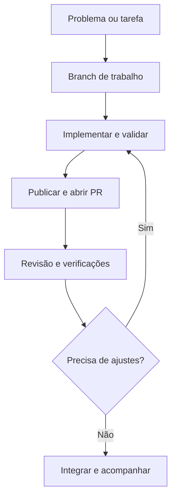
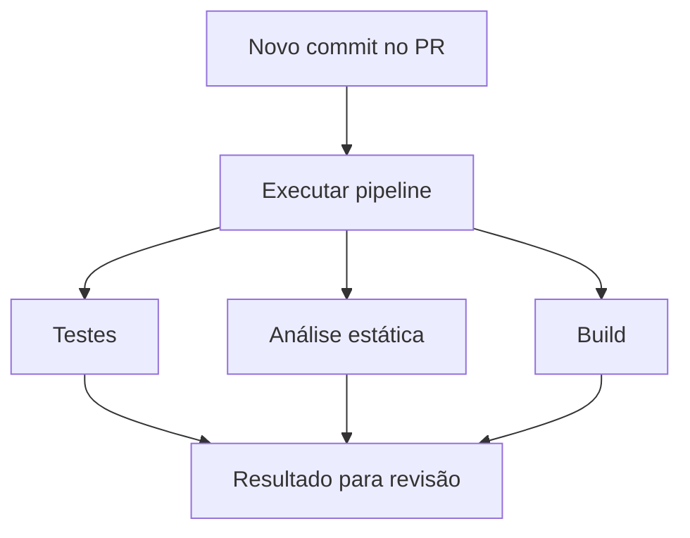
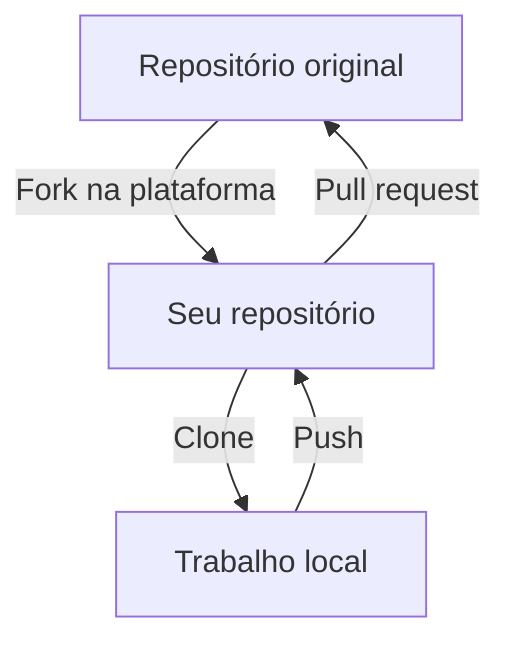

# Colaboração: pull requests, revisão de código e commits claros

## 1. O que significa colaborar com Git?

Colaborar significa desenvolver mudanças que outras pessoas consigam entender, revisar e integrar com segurança.

O Git fornece commits, branches e integração de históricos. Plataformas como GitHub e GitLab acrescentam recursos como pull requests, comentários, verificações e regras de aprovação.

Um fluxo comum envolve:

1. Entender o problema.
2. Criar uma branch.
3. Implementar e validar a mudança.
4. Publicar a branch.
5. Abrir um pull request.
6. Participar da revisão.
7. Integrar e acompanhar o resultado.

## 2. Fluxo de colaboração



As regras variam entre equipes. Antes de começar, consultar o README, o guia de contribuição e as convenções do projeto.

## 3. Branches para mudanças focadas

Uma branch deve representar uma mudança compreensível.

Exemplos:

| Branch | Objetivo |
|---|---|
| `feat/filtro-por-categoria` | Adicionar um filtro |
| `fix/calculo-total` | Corrigir um cálculo |
| `docs/configuracao-local` | Documentar o ambiente |
| `refactor/validacao-pedido` | Reorganizar uma validação |

Evitar misturar uma funcionalidade, uma reformatação geral e uma atualização de dependências sem relação.

**Mudanças focadas facilitam revisão, testes e reversão.**

### Criar a branch

Com as alterações locais organizadas:

```bash
git switch main
git fetch origin
git merge --ff-only origin/main
git switch -c feat/filtro-por-categoria
```

Esse exemplo pressupõe que `main` pode ser atualizada por fast-forward. Se houver divergência, investigar antes de continuar.

## 4. Commits claros

Um commit deve registrar uma unidade coerente de mudança.

A mensagem precisa ajudar outra pessoa a entender o que foi alterado sem depender da conversa original.

### Exemplos

| Mensagem pouco informativa | Mensagem mais clara |
|---|---|
| `ajustes` | `fix: impedir cadastro com email vazio` |
| `update` | `docs: adicionar instruções de execução local` |
| `final` | `feat: adicionar filtro de produtos por categoria` |
| `corrigido` | `fix: preservar filtros ao trocar de página` |

Preferir descrever o comportamento ou a finalidade da alteração.

## 5. Conventional Commits

Conventional Commits é uma convenção para estruturar mensagens. Ela não é obrigatória para usar Git.

Formato básico:

```text
tipo(escopo opcional): descrição
```

Exemplos:

```text
feat(produtos): adicionar filtro por categoria
fix(auth): rejeitar token expirado
docs: explicar configuração do banco
refactor(pedidos): separar validação do cálculo
test: cobrir desconto com percentual zero
chore: atualizar configuração do editor
```

| Tipo comum | Uso |
|---|---|
| `feat` | Adicionar funcionalidade |
| `fix` | Corrigir comportamento |
| `docs` | Alterar documentação |
| `refactor` | Reorganizar código sem pretender alterar comportamento |
| `test` | Adicionar ou ajustar testes |
| `chore` | Manutenção e configurações |

Seguir a convenção do projeto, incluindo idioma e tipos permitidos.

### Mudança incompatível

A convenção permite sinalizar uma quebra de compatibilidade:

```text
feat(api)!: alterar formato da resposta de pedidos
```

Também é possível detalhá-la no corpo:

```text
BREAKING CHANGE: o campo total passa a ser retornado em centavos.
```

Isso comunica incompatibilidade; não substitui planejamento de migração e comunicação aos consumidores.

## 6. Corpo da mensagem

Quando a alteração exigir contexto, acrescentar um corpo explicando a motivação.

```text
fix: preservar filtros ao trocar de página

A navegação descartava os parâmetros de categoria e preço.
Reutilizar os filtros ativos ao montar a próxima requisição.
```

O título resume a mudança. O corpo explica por que ela foi necessária.

Evitar apenas narrar detalhes visíveis no diff, como “adicionar um if”.

## 7. Revisar antes do commit

```bash
git status
git diff
git add caminho/do/arquivo.js
git diff --staged
git diff --staged --check
git commit -m "fix: preservar filtros ao trocar de página"
```

Conferir:

- Se os arquivos preparados pertencem à mesma mudança.
- Se existem logs temporários ou código de depuração.
- Se algum segredo foi incluído.
- Se comentários e documentação continuam corretos.
- Se as verificações relevantes passaram.

**Preparar tudo com `git add .` não substitui revisar o conteúdo.**

## 8. O que é um pull request?

Um pull request, ou PR, é uma proposta de integração entre branches em uma plataforma como GitHub.

Ele reúne:

- A descrição da mudança.
- Os commits e diferenças.
- Discussões e comentários.
- Resultados de verificações automáticas.
- Aprovações e solicitações de ajustes.

GitLab utiliza o termo merge request para um recurso equivalente em finalidade.

**Pull request não é o comando `git pull`.**

| Termo | Significado |
|---|---|
| `git pull` | Buscar e integrar mudanças no repositório local |
| Pull request | Propor e revisar uma integração na plataforma |

## 9. Publicar a branch

```bash
git push -u origin feat/filtro-por-categoria
```

Publicar os commits e configurar o acompanhamento remoto.

Depois, abrir o PR na plataforma, selecionando:

- **Base:** branch que receberá a mudança.
- **Compare/head:** branch que contém a implementação.

### Exemplo

| Campo | Branch |
|---|---|
| Base | `main` |
| Compare/head | `feat/filtro-por-categoria` |

Conferir a base: escolher a branch errada pode incluir commits e arquivos sem relação.

## 10. Escrever um bom PR

O PR deve permitir que alguém entenda o problema e avalie a solução sem conhecer a conversa anterior.

Incluir, conforme a necessidade:

- Problema ou comportamento anterior.
- Comportamento resultante.
- Decisões relevantes.
- Validação realizada.
- Limitações ou cuidados concretos.
- Referência à tarefa relacionada.

### Exemplo de descrição

```markdown
## Problema

Ao trocar de página, a listagem descartava a categoria selecionada.

## Mudança

Preservar os filtros ativos na montagem das requisições de paginação.

## Validação

- Verificado o avanço e o retorno entre páginas com categoria selecionada.
- Adicionado teste para preservar a categoria na próxima requisição.

## Referência

Relacionado à tarefa #123.
```

Para mudanças simples, uma descrição de poucas frases pode ser suficiente.

Não afirmar que um teste foi executado quando ele não foi.

## 11. PR em rascunho — draft

Um draft PR sinaliza que o trabalho ainda não está pronto para integração.

É útil para:

- Compartilhar uma abordagem.
- Solicitar feedback antecipado.
- Dar visibilidade ao andamento.
- Executar verificações enquanto a implementação evolui.

Ao pedir feedback, indicar claramente o que precisa ser avaliado.

Transformar o PR em pronto para revisão quando a mudança estiver concreta e validada conforme o projeto.

## 12. O que avaliar em uma revisão?

Revisar código significa avaliar o comportamento e a manutenção da mudança, não apenas sua aparência.

| Aspecto | Perguntas úteis |
|---|---|
| Correção | A implementação resolve o problema? |
| Casos de borda | Funciona com entrada vazia, ausente ou inválida? |
| Segurança | Há validação, autorização e proteção de dados? |
| Clareza | Os nomes e o fluxo ajudam a entender a regra? |
| Testes | Os testes verificam os comportamentos relevantes? |
| Compatibilidade | Algum consumidor existente será afetado? |
| Desempenho | A mudança introduz trabalho desnecessário relevante? |
| Operação | Exige configuração, migração ou acompanhamento? |

Escalar a profundidade da revisão ao impacto da mudança.

## 13. Fazer autorrevisão

Antes de solicitar revisão:

```bash
git fetch origin
git diff origin/main...HEAD
git log --oneline origin/main..HEAD
```

Esses comandos ajudam a revisar a mudança em relação à base conhecida localmente.

Também conferir o diff exibido no PR.

### Perguntas de autorrevisão

- O PR contém apenas o que pretende entregar?
- A descrição corresponde à implementação final?
- Existe código temporário?
- Algum caso de erro foi ignorado?
- A mudança exige documentação?
- O resultado pode ser entendido sem minha explicação verbal?

## 14. Escrever comentários úteis

Um comentário de revisão deve explicar o problema, seu impacto e, quando possível, uma alternativa.

### Comentário vago

```text
Isso está errado.
```

### Comentário específico

```text
Se a API retornar uma lista vazia, o acesso a itens[0].id lança um erro.
Podemos tratar a ausência de itens antes de acessar o primeiro elemento?
```

### Diferenciar importância

```text
Bloqueante: esta rota permite consultar pedidos de outro usuário.

Sugestão: extrair a condição para um nome que explique a regra.

Dúvida: a ordenação precisa permanecer estável entre páginas?
```

Esses rótulos são exemplos de comunicação, não uma exigência do Git.

Evitar apresentar preferência pessoal de estilo como defeito obrigatório, especialmente quando o projeto já possui ferramentas de formatação.

## 15. Receber e responder feedback

Ao receber um comentário:

1. Entender o cenário apontado.
2. Conferir o comportamento no código.
3. Ajustar quando necessário.
4. Explicar a decisão quando mantiver a implementação.
5. Registrar a validação relevante.

Exemplo:

```text
Ajustado para retornar uma lista vazia quando não houver resultados.
Adicionei um teste para esse cenário.
```

Discordâncias devem se apoiar em requisitos, comportamento, manutenção e evidências.

Evitar alterar o código apenas para encerrar uma discussão sem entender a consequência.

## 16. Atualizar um PR

Normalmente, novos commits publicados na mesma branch aparecem no PR existente.

```bash
git add arquivo.js
git commit -m "fix: tratar resultado vazio na consulta"
git push
```

Não é necessário abrir outro PR para cada ajuste da revisão.

Após atualizar:

- Conferir se as verificações passaram novamente.
- Informar os ajustes relevantes.
- Solicitar nova revisão quando aplicável.

A plataforma pode invalidar aprovações anteriores conforme as regras do repositório.

## 17. Verificações automáticas — CI

CI significa integração contínua.

No contexto de PRs, pipelines podem executar:

- Testes automatizados.
- Linter.
- Verificação de tipos.
- Build.
- Análises de dependências e segurança.



**Pipeline aprovado não garante ausência de problemas.** Ele verifica somente o que foi configurado.

Quando uma etapa falhar, consultar o erro real antes de alterar o código ou repetir a execução.

## 18. Atualizar a branch com a base

Enquanto o PR está aberto, a branch principal pode receber novos commits.

### Atualizar usando merge

```bash
git fetch origin
git switch feat/filtro-por-categoria
git merge origin/main
```

Resolver conflitos, validar e publicar:

```bash
git push
```

### Atualizar usando rebase

```bash
git fetch origin
git switch feat/filtro-por-categoria
git rebase origin/main
```

O rebase reescreve os commits reaplicados. Se já estiverem publicados, atualizar o remoto pode exigir:

```bash
git push --force-with-lease origin feat/filtro-por-categoria
```

Usar esse fluxo apenas quando permitido e coordenado.

**Não executar merge e rebase em sequência por padrão.** Escolher a estratégia do projeto.

## 19. Estratégias de integração

| Estratégia | Resultado típico |
|---|---|
| Merge commit | Preservar a linha da branch e registrar um commit de merge |
| Squash merge | Reunir as alterações do PR em um commit na base |
| Rebase and merge | Reaplicar os commits sobre a base sem criar merge commit |

A implementação exata depende da plataforma e das regras do repositório.

### Merge commit

Útil quando a relação entre as branches deve ficar explícita.

### Squash merge

Útil quando o PR representa uma unidade de mudança, mas contém vários commits intermediários.

A mensagem final precisa descrever a mudança completa.

### Rebase and merge

Produz um histórico linear, preservando a separação lógica entre commits, mas pode gerar novos identificadores.

Não presumir que os commits finais terão os mesmos hashes da branch original.

## 20. Quem pode integrar?

Depende das permissões e proteções do repositório.

A branch principal pode exigir:

- Aprovações.
- Verificações bem-sucedidas.
- Resolução de discussões.
- Atualização em relação à base.
- Ausência de conflitos.
- Uso de uma fila de integração.

Não contornar verificações apenas para concluir o PR mais rápido.

## 21. Depois da integração

### Atualizar a principal local

Com as alterações locais organizadas:

```bash
git switch main
git fetch origin
git merge --ff-only origin/main
```

### Excluir a branch local

```bash
git branch -d feat/filtro-por-categoria
```

O Git pode recusar a exclusão após integração por squash ou rebase, porque os commits originais podem não estar no histórico de `main`.

Nessa situação:

1. Confirmar que o PR foi integrado.
2. Conferir se existe trabalho posterior não publicado.
3. Revisar o resultado na principal.
4. Só então considerar a exclusão forçada da branch.

### Limpar referências remotas obsoletas

```bash
git fetch --prune origin
```

Isso não exclui automaticamente a branch local.

## 22. Colaboração por fork

Quando não há permissão para publicar branches no repositório original, um fluxo comum utiliza um fork.



Nesse fluxo:

- `origin` normalmente aponta para seu fork.
- `upstream` normalmente aponta para o projeto original.
- O PR propõe integrar sua branch no projeto original.

Conferir os destinos antes de publicar ou abrir a proposta.

## 23. Problemas comuns

| Situação | Como investigar |
|---|---|
| PR contém commits inesperados | Conferir a base e o ponto de criação da branch |
| Diff muito grande | Separar mudanças sem relação |
| CI falhou | Ler o log da etapa e reproduzir quando possível |
| Push rejeitado | Buscar e revisar a divergência |
| Conflitos com a principal | Atualizar e resolver conforme o fluxo adotado |
| Revisão demorando | Fornecer contexto e solicitar revisão pelo canal combinado |
| Aprovação removida após push | Conferir as regras de proteção |
| Segredo publicado | Revogar a credencial e seguir o procedimento do projeto; excluir o arquivo não basta |

## 24. Exemplo completo

### Criar uma mudança

```bash
git switch main
git fetch origin
git merge --ff-only origin/main
git switch -c docs/exemplos-de-closures
```

Editar os arquivos e validar o conteúdo.

### Registrar

```bash
git status
git diff
git add closures.js
git diff --staged
git commit -m "docs: adicionar exemplos de closures"
```

### Publicar

```bash
git push -u origin docs/exemplos-de-closures
```

### Abrir o PR

Usar um título como:

```text
docs: adicionar exemplos de closures e estado privado
```

Explicar:

- Quais conceitos foram documentados.
- Como os exemplos foram verificados.
- Se existem limitações relevantes.

### Responder à revisão

Fazer os ajustes necessários e publicar novos commits na mesma branch.

Após a integração, atualizar a principal e remover as branches que não forem mais necessárias.

## Exercício prático

Em um repositório de prática:

1. Criar uma branch de documentação.
2. Adicionar uma explicação e um exemplo.
3. Revisar o diff e criar um commit claro.
4. Publicar a branch.
5. Abrir um PR com problema, mudança e validação.
6. Fazer uma autorrevisão pelo diff da plataforma.
7. Adicionar um comentário específico sobre uma melhoria.
8. Implementar a melhoria e publicar outro commit.
9. Conferir o histórico e as verificações.
10. Integrar conforme as opções disponíveis.

**Objetivo:** praticar não apenas os comandos, mas a apresentação e a revisão de uma mudança.

## Pontos de atenção

- Manter branches e PRs focados.
- Explicar a intenção, não apenas repetir o diff.
- Registrar somente a validação realmente realizada.
- Tratar revisão como discussão técnica sobre a mudança.
- Preferir comentários específicos e acionáveis.
- Respeitar as regras de integração do projeto.
- Não reescrever uma branch compartilhada sem coordenação.
- Acompanhar o resultado depois da integração quando a mudança exigir.