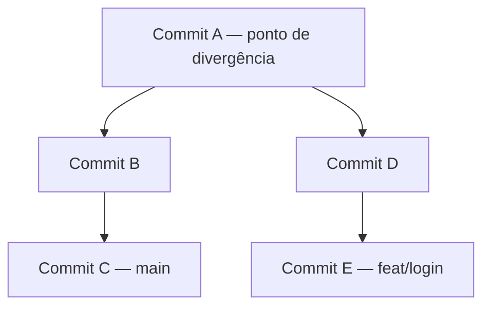
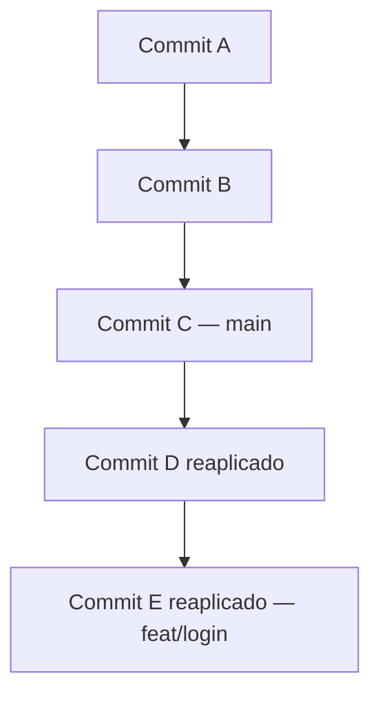
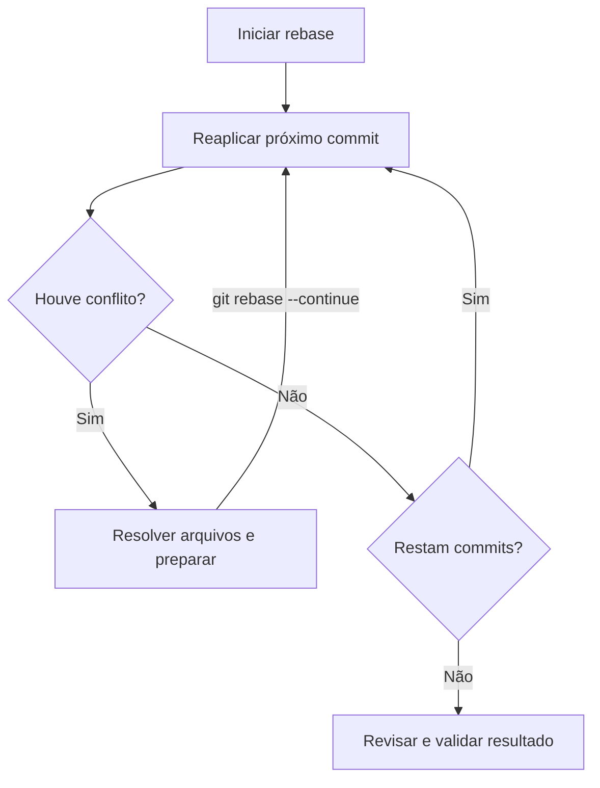

# Rebase: atualizar branches e reorganizar commits

## 1. O que é rebase?

Rebase é uma operação que reaplica commits sobre outra base.

Ele é usado para:

- Atualizar uma branch com mudanças da principal.
- Organizar commits antes de uma revisão.
- Corrigir mensagens.
- Reunir commits relacionados.
- Remover commits de uma sequência.
- Transferir uma sequência de commits para outra base.

**Rebase reescreve histórico:** os commits reaplicados normalmente recebem novos identificadores.

Ele não altera os objetos dos commits antigos. Cria outros commits e reposiciona a branch.

## 2. O que significa “base”?

A base é o ponto do histórico sobre o qual os commits serão reaplicados.

Supondo que uma branch de funcionalidade tenha começado em um commit antigo da `main`, um rebase permite reaplicar seu trabalho sobre uma versão mais recente da principal.

### Antes



### Depois do rebase



Os commits reaplicados podem preservar as alterações e mensagens, mas possuem outra ancestralidade.

Como os pais participam da identidade de um commit, seus identificadores mudam.

## 3. Merge e rebase

| Aspecto | Merge | Rebase |
|---|---|---|
| Como integrar a base | Combinar os históricos | Reaplicar commits sobre a base |
| Commits originais da branch | Preservar | Normalmente substituir por novos |
| Histórico resultante | Pode mostrar ramificações e merge | Normalmente linearizar a sequência |
| Uso em branch compartilhada | Não exige reescrever commits anteriores | Exige coordenação se os commits já foram publicados |
| Conflitos | Podem ocorrer na integração | Podem ocorrer em cada commit reaplicado |

Nenhuma estratégia elimina a necessidade de revisão e testes.

**Escolher conforme o fluxo do projeto, não pela aparência do histórico isoladamente.**

## 4. Atualizar uma branch com rebase

Supondo que:

- A principal remota seja `origin/main`.
- A branch de trabalho seja `feat/login`.
- O diretório de trabalho esteja limpo.

```bash
git fetch origin
git switch feat/login
git rebase origin/main
```

### O que acontece?

1. `fetch` atualiza o conhecimento local sobre o remoto.
2. `switch` seleciona a branch de trabalho.
3. `rebase` identifica os commits locais a reaplicar.
4. O Git reaplica essa sequência sobre `origin/main`.
5. A branch passa a apontar para o resultado.

`origin/main` não é modificada pelo rebase.

Commits equivalentes já presentes na base podem ser reconhecidos e omitidos. O resultado não é necessariamente uma reprodução literal de todos os commits originais.

## 5. Preparar o trabalho antes de começar

```bash
git status
git log --oneline --graph --decorate --all
```

Conferir:

- Qual branch está em uso.
- Qual será a nova base.
- Quais commits serão afetados.
- Se existem alterações locais.
- Se os commits já foram compartilhados.

### Preservar uma referência para o histórico anterior

```bash
git branch backup/login-antes-do-rebase
```

Criar uma branch apontando para o commit atual.

Essa referência facilita comparar ou recuperar os commits anteriores.

**A branch de backup não preserva edições não commitadas.**

### Guardar alterações temporariamente

Quando apropriado:

```bash
git stash push -u -m "rascunho antes do rebase"
```

A opção `-u` inclui arquivos untracked, mas não arquivos ignorados.

Após o rebase:

```bash
git stash apply
```

A reaplicação também pode gerar conflitos. Conferir o resultado antes de remover o stash.

## 6. Conflitos durante rebase

O rebase reaplica commits individualmente.

Um conflito acontece quando o Git não consegue aplicar um deles automaticamente sobre o estado atual.

### Fluxo de resolução



É possível resolver um conflito e encontrar outro no commit seguinte.

## 7. Resolver conflitos passo a passo

### Identificar os arquivos

```bash
git status
git diff
```

### Consultar o commit que está sendo reaplicado

```bash
git rebase --show-current-patch
```

Entender o objetivo daquele commit antes de editar a resolução.

### Resolver os arquivos

Remover os marcadores e construir o resultado correto.

A solução deve considerar:

- A versão atualizada da base.
- A intenção do commit reaplicado.
- O comportamento esperado do projeto.

### Preparar a resolução

```bash
git add arquivo-resolvido.js
```

Para confirmar a exclusão de um arquivo:

```bash
git rm arquivo-excluido.js
```

### Continuar

```bash
git rebase --continue
```

Repetir o processo enquanto houver conflitos.

**Normalmente, não é necessário criar um commit manual entre `add` e `rebase --continue`.** O rebase administra a reaplicação.

## 8. Ours e theirs durante rebase

Em um rebase comum, os significados podem surpreender:

| Termo | Conteúdo |
|---|---|
| `ours` | Histórico que já está sendo reconstruído sobre a nova base |
| `theirs` | Commit da branch de trabalho que está sendo reaplicado |

Por isso, “ours” não significa necessariamente sua versão original da branch de trabalho.

```bash
git restore --ours -- arquivo.js
```

Escolher a versão do histórico reconstruído.

```bash
git restore --theirs -- arquivo.js
```

Escolher a versão do commit em reaplicação.

Depois:

```bash
git add arquivo.js
git rebase --continue
```

Essas opções substituem o conteúdo inteiro do arquivo. Revisar o que será descartado antes de usá-las.

## 9. Cancelar um rebase

```bash
git rebase --abort
```

Cancelar a operação em andamento e retornar à posição anterior ao rebase.

Esse comando não desfaz um rebase já concluído.

## 10. Pular um commit

```bash
git rebase --skip
```

Ignorar o commit atualmente em reaplicação e continuar.

**Não usar como solução genérica para conflitos.** O comando pode descartar uma alteração necessária.

Usar somente após confirmar que aquele commit não deve participar do resultado, por exemplo, porque sua mudança já foi incorporada por outra alteração.

## 11. O que é rebase interativo?

O rebase interativo permite escolher ações para os commits de uma sequência.

```bash
git rebase -i HEAD~3
```

Abrir a lista dos três commits mais recentes, seguindo um histórico linear simples.

Essa forma pressupõe que `HEAD~3` existe.

A lista aparece da ordem mais antiga para a mais recente:

```text
pick a1b2c3d adicionar validação
pick b2c3d4e corrigir mensagem
pick c3d4e5f ajustar caso vazio
```

Alterar a ação de cada linha define como o Git reconstruirá a sequência.

## 12. Ações do rebase interativo

| Ação | Finalidade |
|---|---|
| `pick` | Reaplicar o commit |
| `reword` | Reaplicar e editar a mensagem |
| `edit` | Pausar após reaplicar para permitir alterações |
| `squash` | Unir ao commit anterior e editar a mensagem combinada |
| `fixup` | Unir ao anterior, normalmente descartando a mensagem deste commit |
| `drop` | Remover o commit da sequência |
| `exec` | Executar um comando naquele ponto |

Também é possível reorganizar as linhas para alterar a ordem dos commits.

**Mudar a ordem pode gerar conflitos ou estados intermediários inválidos.**

## 13. Corrigir uma mensagem com reword

Lista original:

```text
pick a1b2c3d adicionar validação
pick b2c3d4e ajustes
pick c3d4e5f ajustar caso vazio
```

Alteração:

```text
pick a1b2c3d adicionar validação
reword b2c3d4e ajustes
pick c3d4e5f ajustar caso vazio
```

Ao continuar, o Git abre um editor para substituir a mensagem daquele commit.

Mesmo sem alterar arquivos, a mudança da mensagem cria outro commit e afeta os identificadores dos descendentes reaplicados.

## 14. Reunir commits com squash

Supondo três commits que representam uma única mudança:

```text
pick a1b2c3d adicionar validação
squash b2c3d4e corrigir mensagem
squash c3d4e5f ajustar caso vazio
```

O Git combina os três em um e permite editar a mensagem final.

Exemplo:

```text
feat: validar os dados de cadastro
```

Usar quando os commits intermediários não precisam permanecer separados.

Não reunir mudanças independentes apenas para reduzir a quantidade de commits.

## 15. Reunir correções com fixup

```text
pick a1b2c3d adicionar validação
fixup b2c3d4e corrigir mensagem
fixup c3d4e5f ajustar caso vazio
```

Combinar as alterações no primeiro commit, mantendo sua mensagem no uso básico de `fixup`.

A diferença principal em relação a `squash` é o tratamento da mensagem.

## 16. Corrigir um commit com edit

Marcar o commit desejado:

```text
edit a1b2c3d adicionar validação
pick b2c3d4e documentar comportamento
```

Quando o Git pausar:

1. Editar os arquivos.
2. Preparar as mudanças.
3. Substituir o commit.
4. Continuar.

```bash
git add arquivo.js
git commit --amend --no-edit
git rebase --continue
```

Remover `--no-edit` quando também for necessário alterar a mensagem.

## 17. Dividir um commit

Em um histórico linear, usar `edit` no commit que será dividido.

Quando o rebase pausar:

```bash
git reset HEAD~1
```

Voltar um commit, mantendo o conteúdo no diretório de trabalho.

Depois, selecionar partes:

```bash
git add -p
git commit -m "feat: adicionar validação de entrada"
```

Preparar o restante:

```bash
git add arquivo.js
git commit -m "docs: explicar a validação"
git rebase --continue
```

Antes de continuar, confirmar que todas as alterações desejadas foram registradas e que o estado está apropriado.

Esse procedimento pressupõe um commit com pai e exige cuidado com alterações dependentes.

## 18. Autosquash: associar uma correção ao commit certo

Criar um commit de correção:

```bash
git add arquivo.js
git commit --fixup=IDENTIFICADOR_DO_COMMIT
```

O Git cria uma mensagem especial que identifica o commit a corrigir.

Depois:

```bash
git rebase -i --autosquash origin/main
```

O rebase interativo organiza os commits de correção próximos de seus alvos e ajusta as ações.

Revisar a lista antes de confirmar. O alvo precisa estar na sequência apropriada para a combinação.

## 19. Rebase --onto

`--onto` permite separar:

- A nova base.
- O limite usado para selecionar os commits.
- A branch que será reposicionada.

Formato:

```bash
git rebase --onto NOVA_BASE BASE_ANTIGA BRANCH
```

### Exemplo

Supondo que:

- `feat/api` foi criada a partir de `main`.
- `feat/tela` foi criada a partir de `feat/api`.
- A tela não depende mais dos commits da API.

```bash
git rebase --onto main feat/api feat/tela
```

Reaplicar em `main` os commits de `feat/tela` que não estão em `feat/api`.

Isso muda a ancestralidade, mas não remove dependências reais do código. Se a tela ainda utiliza a API, o resultado pode deixar de funcionar.

Usar somente depois de revisar o intervalo de commits e suas dependências.

## 20. Branches que contêm merges

Por padrão, o rebase normalmente não preserva a topologia original dos merges.

A opção abaixo tenta recriar essa estrutura:

```bash
git rebase --rebase-merges origin/main
```

Esse cenário exige atenção adicional:

- Merges podem precisar ser refeitos.
- Resoluções anteriores podem precisar ser reaplicadas.
- O histórico reconstruído deve ser revisado.

Para começar, praticar rebase em sequências lineares de commits.

## 21. Validar o resultado

Após concluir:

```bash
git status
git log --oneline --graph --decorate --all
git diff origin/main...HEAD
```

Conferir:

- Se a branch está na base pretendida.
- Se as mudanças desejadas continuam presentes.
- Se algum commit foi removido indevidamente.
- Se os arquivos finais fazem sentido.
- Se os testes e verificações relevantes passam.

### Comparar a sequência anterior com a nova

Se foi criada uma branch de backup:

```bash
git range-diff origin/main..backup/login-antes-do-rebase origin/main..feat/login
```

Comparar as duas séries de patches.

`range-diff` ajuda a identificar diferenças entre versões de uma sequência de commits. Não substitui a revisão do resultado final.

## 22. Publicar depois do rebase

### Branch ainda não publicada

```bash
git push -u origin feat/login
```

### Branch publicada com histórico reescrito

Um push comum pode ser recusado porque a atualização não é fast-forward.

Quando a reescrita for permitida e coordenada:

```bash
git push --force-with-lease origin feat/login
```

`--force-with-lease` verifica se o remoto corresponde ao estado esperado antes de permitir a atualização.

Na forma padrão, a expectativa costuma vir da referência de acompanhamento local. Um fetch automático pode alterar essa expectativa.

**A opção reduz riscos, mas não garante que sobrescrever o histórico seja apropriado.**

Evitar rebase seguido de force push em branches principais ou usadas por outras pessoas sem uma decisão explícita da equipe.

## 23. Recuperar um rebase concluído

Se o resultado estiver incorreto:

```bash
git reflog
```

Localizar o commit da branch antes do rebase.

Inspecionar:

```bash
git show IDENTIFICADOR_ANTERIOR
```

Preservar uma referência:

```bash
git branch recuperacao/antes-do-rebase IDENTIFICADOR_ANTERIOR
```

Se existe uma branch de backup, ela já fornece esse ponto de recuperação.

Criar a branch permite revisar o histórico antigo sem descartar imediatamente o estado atual.

O reflog é local e possui retenção limitada. Não é um backup permanente.

## 24. Problemas comuns

| Situação | Como investigar |
|---|---|
| Rebase não começa | Conferir alterações locais com `git status` |
| Conflitos repetidos | Analisar cada commit e sua intenção |
| Commit parece desaparecer | Conferir se foi omitido por equivalência, ficou vazio ou foi removido na lista |
| Push rejeitado após rebase | Confirmar se o histórico remoto precisa ser reescrito e se isso é permitido |
| Resultado compila, mas funciona diferente | Revisar resoluções e executar testes de comportamento |
| Sequência errada no modo interativo | Abortar se ainda estiver em andamento ou recuperar pelo backup/reflog |
| Dependências entre commits foram quebradas | Rever a ordem e a separação lógica das mudanças |

## 25. Quando usar e quando evitar

### Usar quando

- A equipe adota atualização por rebase.
- A branch é de uso individual.
- Os commits ainda não foram compartilhados.
- É necessário melhorar a sequência antes da revisão.
- Existe uma razão concreta para mudar a base.

### Evitar quando

- Outras pessoas dependem dos commits e não houve coordenação.
- O objetivo pode ser atendido por um novo commit simples.
- A reescrita dificulta uma revisão já em andamento.
- Não está claro quais commits serão reaplicados.
- A intenção é apenas “deixar o gráfico bonito”.

## Exercício prático

Em um repositório de prática:

1. Criar uma branch `estudos/rebase` a partir de `main`.
2. Criar dois commits alterando um arquivo de estudos.
3. Voltar à `main`.
4. Criar um commit em outro arquivo.
5. Retornar à branch de estudos.
6. Criar uma branch de backup.
7. Executar `git rebase main`.
8. Consultar o gráfico e comparar os identificadores dos commits.
9. Executar `git rebase -i HEAD~2`.
10. Unir os dois commits de estudo usando `fixup`.
11. Conferir o conteúdo final e executar as verificações relevantes.

**Resultado esperado:** os commits de estudo passam a ter como base a nova ponta de `main`, e depois são reunidos em um único commit.

## Resumo dos comandos

| Comando | Finalidade |
|---|---|
| `git rebase origin/main` | Reaplicar a branch sobre a base atualizada |
| `git rebase -i HEAD~3` | Organizar três commits em um histórico linear |
| `git rebase --show-current-patch` | Consultar o commit em reaplicação |
| `git rebase --continue` | Continuar após resolver uma pausa |
| `git rebase --abort` | Cancelar um rebase em andamento |
| `git rebase --skip` | Ignorar o commit atual |
| `git commit --fixup=COMMIT` | Criar uma correção associada |
| `git rebase -i --autosquash BASE` | Organizar correções automaticamente |
| `git rebase --onto NOVA ANTIGA BRANCH` | Reaplicar um intervalo sobre outra base |
| `git reflog` | Localizar posições anteriores |

## Pontos de atenção

- Rebase reconstrói commits; não modifica os objetos antigos.
- Novos identificadores afetam quem depende do histórico anterior.
- Resolver conflitos exige preservar a intenção de cada mudança.
- `--skip` pode descartar trabalho.
- Reorganizar commits pode alterar estados intermediários e dependências.
- Revisar o resultado final mesmo quando não houver conflitos.
- Preservar uma referência antes de reescritas importantes.
- Publicar histórico reescrito somente quando permitido e coordenado.