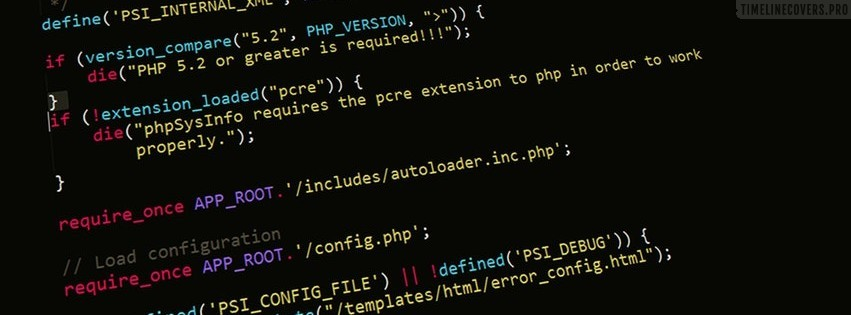

# Learning Hub

✨ _Meu cantinho para aprender, criar e evoluir na tecnologia._

Repositório pessoal de estudos independentes em programação, engenharia de software, dados e inteligência artificial. 💗



## Português

### Sobre ✨

O **Learning Hub** reúne anotações, exercícios, experimentos e registros de progresso desenvolvidos por estudo pessoal. O objetivo é construir uma base técnica sólida por meio de pesquisa, prática ativa, revisão e documentação.

Este repositório não é um projeto de software entregue nem uma coleção de soluções geradas por inteligência artificial. Todo conteúdo prático deve refletir o aprendizado e o trabalho independente da autora.

Aqui, cada conceito estudado é uma nova habilidade e cada exercício concluído é um passo mais bonito rumo à confiança técnica. 🌸

### Áreas de estudo

- Python e fundamentos de programação
- Ciência da computação
- Desenvolvimento backend
- PHP e Laravel
- Vue
- Engenharia de dados
- Matemática e estatística
- Machine learning e deep learning
- Inteligência artificial
- Inteligência artificial generativa
- Engenharia de IA

### Método de estudo 💡

1. **Pesquisar:** consultar documentação oficial, livros, cursos e fontes acadêmicas confiáveis.
2. **Compreender:** explicar os conceitos com as próprias palavras.
3. **Praticar:** resolver exercícios e implementar exemplos sem copiar soluções prontas.
4. **Experimentar:** testar hipóteses e comparar diferentes abordagens.
5. **Registrar:** manter notas claras sobre decisões, erros e conclusões.
6. **Revisar:** revisitar assuntos anteriores e consolidar o conhecimento.

### Estrutura atual 📚

```text
learning-hub/
├── 001 - PHP/
│   └── 000 - Improving the base/
├── cover-web.png
├── agents.md
├── claude.md
└── readme.md
```

A organização pode evoluir conforme novos módulos e tópicos forem estudados. Pastas e arquivos novos devem manter nomenclatura técnica em inglês e uma hierarquia clara.

### Princípios 🤍

- Aprendizagem independente e resolução de problemas
- Uso de fontes oficiais e referências confiáveis
- Nenhuma solução prática gerada por IA apresentada como trabalho próprio
- Conceitos entendidos antes da aplicação
- Código e exercícios escritos pela autora
- Revisão periódica dos registros de estudo
- Preservação da autenticidade do processo de aprendizagem

### Como navegar 🌷

- Comece pela pasta relacionada ao assunto estudado.
- Leia primeiro as anotações teóricas disponíveis.
- Faça os exercícios antes de consultar referências externas.
- Registre erros, dúvidas e aprendizados no próprio material.
- Revise os temas periodicamente.

### Convenções

- **Idioma:** português para explicações pessoais e inglês para terminologia técnica, nomes de pastas, nomes de arquivos e funções.
- **Notas:** objetivos, conceitos, exemplos pessoais e conclusões.
- **Prática:** resultados, testes, reflexões e próximos passos escritos pela autora.
- **Confiabilidade:** separar fatos verificados de hipóteses ou interpretações.

### Estado atual 🚀

O repositório está em construção. A presença de uma pasta indica uma área de estudo iniciada ou em preparação; ela não representa necessariamente que todos os exercícios daquela área estejam concluídos.

---

## English

### About ✨

**Learning Hub** is a personal repository for independent study in programming, software engineering, data, and artificial intelligence.

It contains notes, exercises, experiments, and progress records created through personal research and practice. This is not an application or a collection of AI-generated solutions; practical work should represent the owner's independent learning process.

Every concept studied becomes a new skill, and every completed exercise is another step toward technical confidence. 🌸

### Study areas

- Python and programming fundamentals
- Computer science
- Backend development
- PHP and Laravel
- Vue
- Data engineering
- Mathematics and statistics
- Machine learning and deep learning
- Artificial intelligence
- Generative AI
- AI engineering

### Learning workflow 💡

1. **Research** official documentation, books, courses, and reliable academic sources.
2. **Understand** by explaining concepts in your own words.
3. **Practice** by solving exercises and building examples independently.
4. **Experiment** with hypotheses and compare approaches.
5. **Document** decisions, errors, and conclusions clearly.
6. **Review** earlier topics to consolidate knowledge.

### Repository principles 🤍

- Independent learning and problem-solving
- Reliable and preferably official sources
- No AI-generated implementations presented as personal work
- Concepts understood before application
- Exercises and code written by the learner
- Regular review of study records
- Authenticity of the learning process

### Current structure 📚

```text
learning-hub/
├── 001 - PHP/
│   └── 000 - Improving the base/
├── cover-web.png
├── agents.md
├── claude.md
└── readme.md
```

The structure may evolve as new subjects and modules are added.

### Conventions

- Use Portuguese for personal explanations.
- Use consistent English technical terminology.
- Prefer English for technical folder, file names and functions.
- Keep verified information separate from hypotheses and personal interpretations.
- Do not add finished implementations or study achievements without the learner's own work.

### Current status 🚀

This repository is under continuous development. A folder represents an area that has been started or is being prepared; it does not imply that every exercise in that area has been completed.

---

**Aprenda de forma independente. Pratique com consistência. Entenda profundamente.**

**Learn independently. Practice consistently. Understand deeply.**
